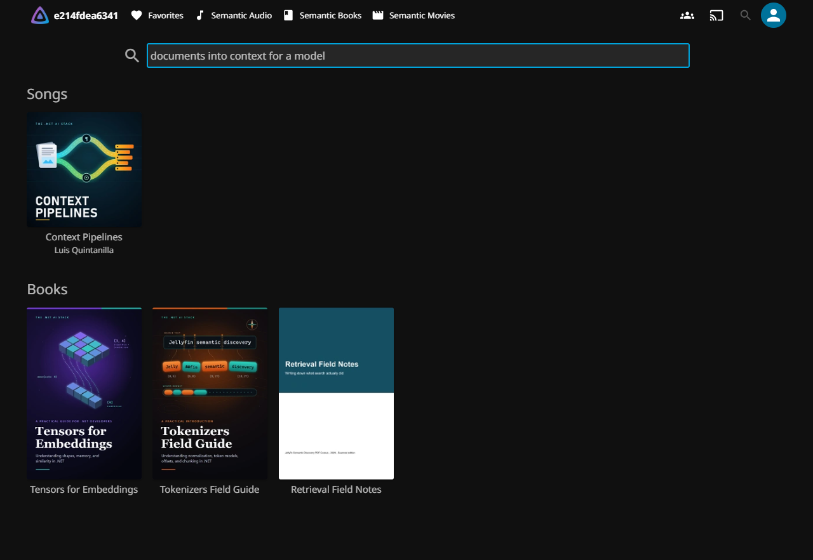
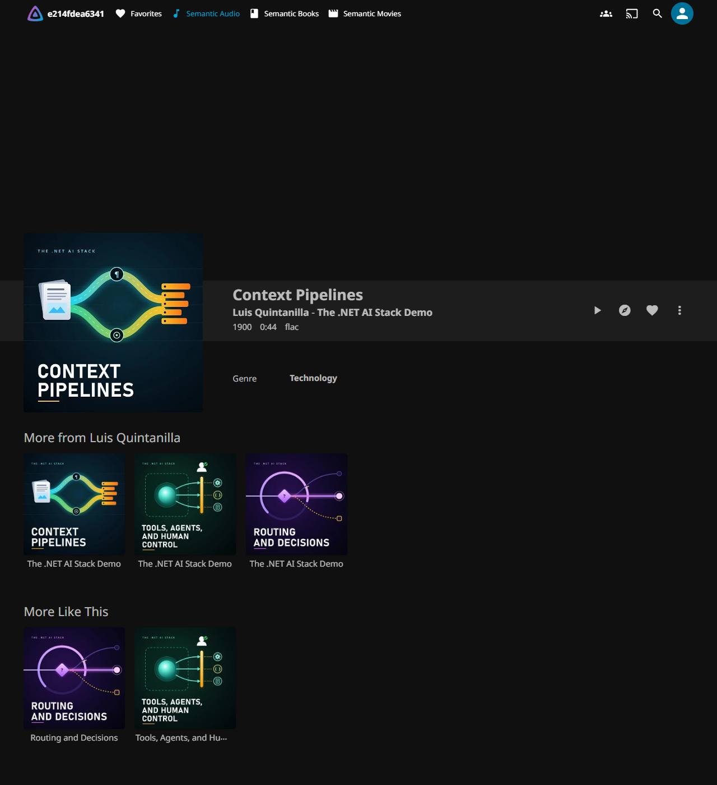

# Jellyfin Semantic Discovery

Search a Jellyfin library by meaning ("a book about reading scanned pages with a
vision model") instead of by title, and get "More Like This" picks that understand
what an item is about. Jellyfin itself is unchanged: a small plugin forwards
search to a .NET service built from off-the-shelf .NET AI building blocks.

This is a sample. It's meant to show **how little code it takes to compose the
.NET AI stack into an existing app**, not to be a product.





## Run it

You need the .NET SDK 11.0.100, Docker, and PowerShell 7.

```powershell
dotnet tool restore
dotnet build Jellyfin.SemanticDiscovery.slnx
dotnet tool run aspire -- run --apphost src/Jellyfin.SemanticDiscovery.AppHost/Jellyfin.SemanticDiscovery.AppHost.csproj
```

Aspire starts Qdrant, Ollama (it pulls `embeddinggemma` the first time), the
semantic service, and Jellyfin with the plugin. `jellyfin-setup` then creates the
libraries, scans them, indexes everything, and exits. Sign in with the
credentials in `.data/jellyfin-login.json` and search from the Jellyfin search box.

### Reading the scanned book

One of the demo books is a scan: no text layer, only page images. To read it, give
the service a vision model. Either one works, and with both, the cloud model goes
first and the local one is the fallback.

| Option | How |
| --- | --- |
| An Azure OpenAI deployment you already have (fast) | `dotnet user-secrets --project src/Jellyfin.SemanticDiscovery.AppHost set ConnectionStrings:page-reader "Endpoint=https://<resource>.openai.azure.com/;Deployment=<vision-model>"`. Auth is your `az login` (Microsoft Entra ID); there are no keys. |
| A local model in Ollama (private, slower) | `$env:SEMANTIC_DISCOVERY_LOCAL_VISION = "true"` pulls `qwen3-vl:8b-instruct`. |

Without either, everything else still works; the scanned book is just not searchable
by its contents.

### Switches

| Variable | Values | Effect |
| --- | --- | --- |
| `SEMANTIC_DISCOVERY_PROFILE` | `demo` (default), `ci` | `ci` uses no chat models and gives Qdrant no volume, so each run starts empty. |
| `SEMANTIC_DISCOVERY_OLLAMA_GPU` | `nvidia`, `amd` | Runs Ollama on your GPU. |
| `SEMANTIC_DISCOVERY_LOCAL_VISION` | `true` | Adds the local vision model as a chat route (demo profile). |
| `SEMANTIC_DISCOVERY_DATA` | a path | Where Jellyfin config and the login file go (default `.data`). |

## Where to look

Each building block lives in one file.

| Building block | What it does here | File |
| --- | --- | --- |
| Aspire | Starts Qdrant, Ollama, the service, Jellyfin, and setup | [AppHost.cs](src/Jellyfin.SemanticDiscovery.AppHost/AppHost.cs) |
| `IEmbeddingGenerator` (Ollama) | Turns item text, book chunks, and queries into vectors | [Program.cs](src/Jellyfin.SemanticDiscovery.SemanticService/Program.cs) |
| `VectorStore` (Qdrant) | Stores and searches those vectors | [Search/MediaIndex.cs](src/Jellyfin.SemanticDiscovery.SemanticService/Search/MediaIndex.cs), [Search/SemanticSearch.cs](src/Jellyfin.SemanticDiscovery.SemanticService/Search/SemanticSearch.cs) |
| `DocumentExtractionClient` + middleware | Reads PDFs: PdfPig for text, a vision model for scans | [Reading/PageReading.cs](src/Jellyfin.SemanticDiscovery.SemanticService/Reading/PageReading.cs) |
| `IChatClient` + `OrderedFailoverChatClient` | Azure OpenAI first, local Ollama second | [Reading/PageReading.cs](src/Jellyfin.SemanticDiscovery.SemanticService/Reading/PageReading.cs) |
| `IngestionPipeline` (DataIngestion) | Reader → `HeaderChunker` → `VectorStoreWriter` | [Ingestion/BookIngestion.cs](src/Jellyfin.SemanticDiscovery.SemanticService/Ingestion/BookIngestion.cs) |
| Extraction → ingestion bridge | Maps extracted headings, tables, and figures to ingestion elements | [Ingestion/ExtractionReader.cs](src/Jellyfin.SemanticDiscovery.SemanticService/Ingestion/ExtractionReader.cs) |
| Jellyfin plugin | Search box, More Like This, and the sync task | [SemanticSearchProvider.cs](src/Jellyfin.SemanticDiscovery.Plugin/SemanticSearchProvider.cs), [SyncTask.cs](src/Jellyfin.SemanticDiscovery.Plugin/SyncTask.cs) |

[docs/architecture.md](docs/architecture.md) has the diagrams and the request flows.
For more extraction patterns (keyed clients, middleware, routing, ingestion), see
[dotnet-document-extraction-samples](https://github.com/luisquintanilla/dotnet-document-extraction-samples).

## Layout

| Folder | |
| --- | --- |
| [src/Jellyfin.SemanticDiscovery.AppHost](src/Jellyfin.SemanticDiscovery.AppHost) | Aspire orchestration |
| [src/Jellyfin.SemanticDiscovery.SemanticService](src/Jellyfin.SemanticDiscovery.SemanticService) | The AI part: reading, ingestion, search (minimal API) |
| [src/Jellyfin.SemanticDiscovery.Plugin](src/Jellyfin.SemanticDiscovery.Plugin) | Thin Jellyfin plugin (`net10.0`, Jellyfin's runtime) |
| [src/Jellyfin.SemanticDiscovery.Setup](src/Jellyfin.SemanticDiscovery.Setup) | One-shot Jellyfin setup for the demo |
| [src/Jellyfin.SemanticDiscovery.ServiceDefaults](src/Jellyfin.SemanticDiscovery.ServiceDefaults) | Aspire service defaults |
| [assets/demo](assets/demo) | The demo library: 3 movies, 3 songs, 4 books, with artwork |
| [tests](tests) | Unit tests and end-to-end tests against a real Jellyfin |

## Tests

```powershell
dotnet test tests/Jellyfin.SemanticDiscovery.Tests
./scripts/Test-EndToEnd.ps1                              # ci profile: text-layer books only
./scripts/Test-EndToEnd.ps1 -Profile demo -OllamaGpu nvidia  # also reads the scanned book
```

The end-to-end script starts the AppHost, waits for setup, searches Jellyfin over
its HTTP API, and stops everything.

## License

Code is [MIT](LICENSE). The demo media is CC BY 4.0; see
[assets/demo](assets/demo/README.md). Third-party notices are in
[THIRD-PARTY-NOTICES.md](THIRD-PARTY-NOTICES.md).
