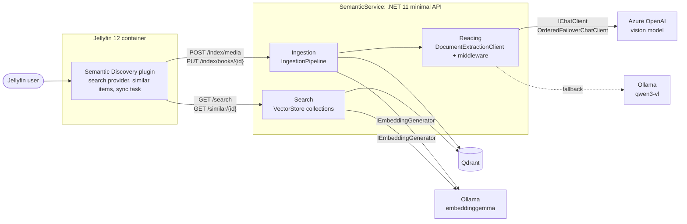
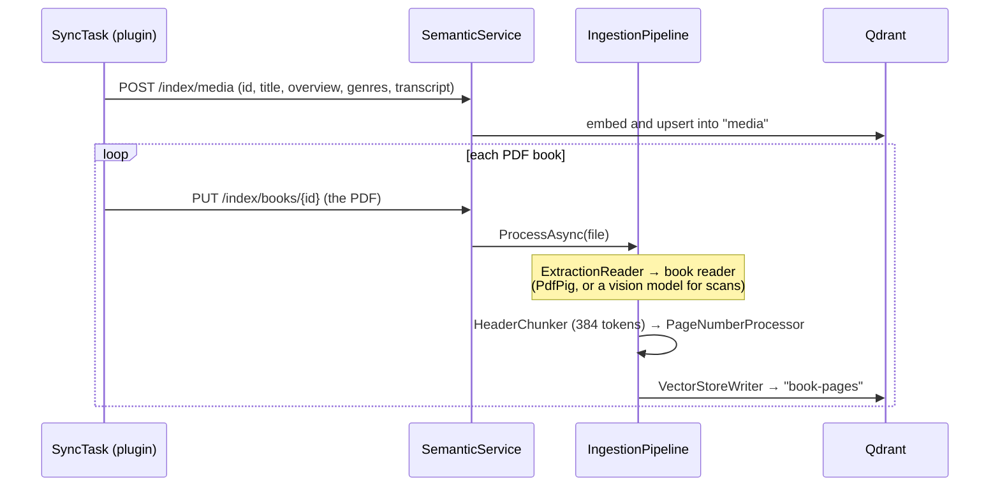
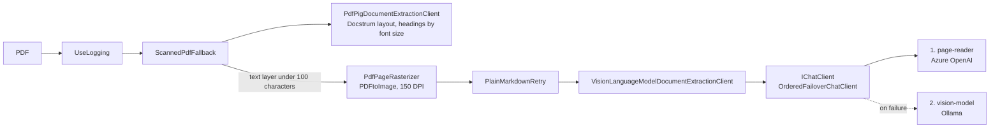
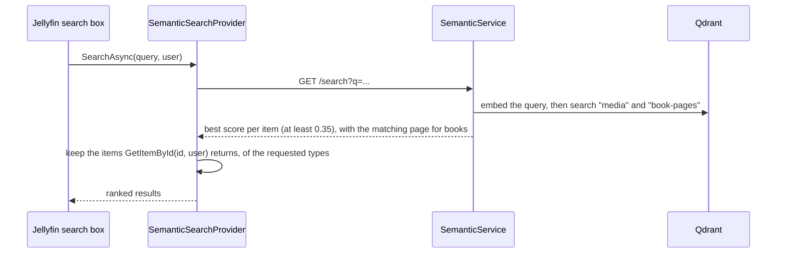

# Architecture

Jellyfin stays as it is. A plugin inside Jellyfin forwards search and
"More Like This" to a separate .NET service, and the service does the AI work with
the .NET AI building blocks. Aspire starts everything.

Aspire ([AppHost.cs](../src/Jellyfin.SemanticDiscovery.AppHost/AppHost.cs)) starts
Qdrant, Ollama, the service, and Jellyfin, then runs `jellyfin-setup` once to create
the libraries, scan them, and run the first sync.

## Indexing

The plugin's **Sync semantic index** task runs at startup and then every 24 hours.

- **`media`** has one point per Jellyfin item, keyed by the item id. Its text is
  the title, overview, genres, tags, year, and, for movies and songs, the transcript.
- **`book-pages`** has the chunks that `VectorStoreWriter` writes. `documentid` is
  the Jellyfin item id. The metadata holds the page number and the PDF's hash, so
  the next sync skips an unchanged book.

### Reading a book

The book reader is a keyed `DocumentExtractionClient` with middleware around it
(see [PageReading.cs](../src/Jellyfin.SemanticDiscovery.SemanticService/Reading/PageReading.cs)):

Only the chat routes that have a connection string are registered. With no routes
(the `ci` profile) the fallback middleware isn't added, and a scanned book gets no
chunks.

## Search

**More Like This** reads the item's vector from `media` (`IncludeVectors = true`),
searches with it, and drops the item itself.

Permissions stay in Jellyfin. The service knows nothing about users; the plugin
drops every hit the current user can't load.

## Profiles

| | `ci` | `demo` (default) |
| --- | --- | --- |
| Qdrant | No volume; starts empty each run | `jellyfin-semantic-discovery-qdrant` volume |
| Embeddings | Ollama `embeddinggemma` | Same |
| Chat routes | None | `page-reader` if its connection string is set; `vision-model` if `SEMANTIC_DISCOVERY_LOCAL_VISION=true` |
| Scanned book | Not searchable by its contents | Read by the vision model |
